# Rally Arcade

Protótipo de corrida arcade de rally para celular em **portrait**, com controles de toque simples. O carro derrapa, seis tipos de cenário/piso mudam o grip, e cada corrida termina com tempo, três parciais e medalha.

Stack: **Vite + TypeScript estrito + Three.js**, física própria (sem engine), UI em DOM/CSS sobre o canvas.

**Jogue agora:** <https://rigato.github.io/rally-arcade/>

> Status: **MVP completo — M5, com powerups (M5b), controles touch de uma mão, pista A→B, cenários de floresta, deserto, neve, vilarejo, estrada de terra e praia, bifurcações procedurais v2, obstáculos móveis, menu de pistas e velocímetro**. O ciclo largada → 3 parciais → chegada → medalha → reinício está fechado. **Ao abrir, o jogo sorteia uma pista procedural**; o menu **PISTAS** permite escolher uma seed ou a pista fixa. As pistas aleatórias têm sete tipos de curva, setores longos, platôs, chokes, 1–2 bifurcações e 1–3 obstáculos móveis. O gerador anterior continua disponível em `?gen=v1`.

## Screenshots

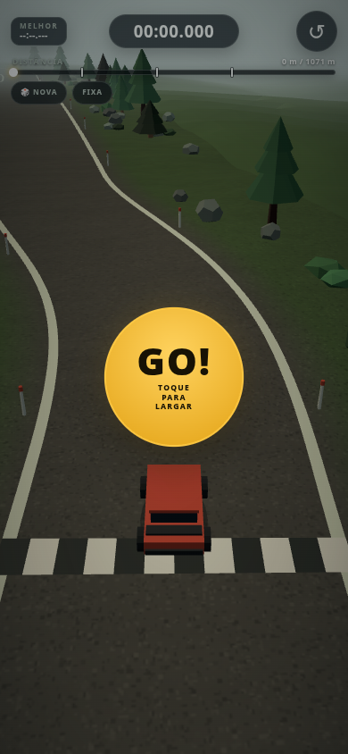

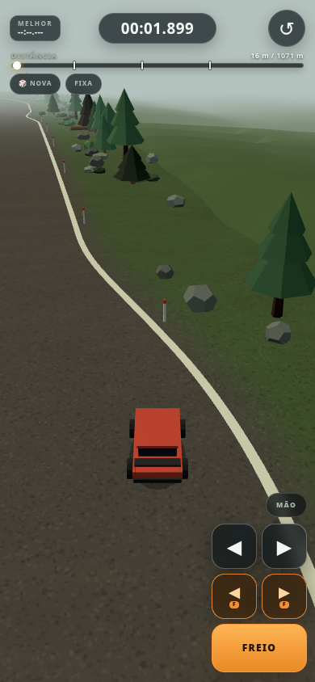

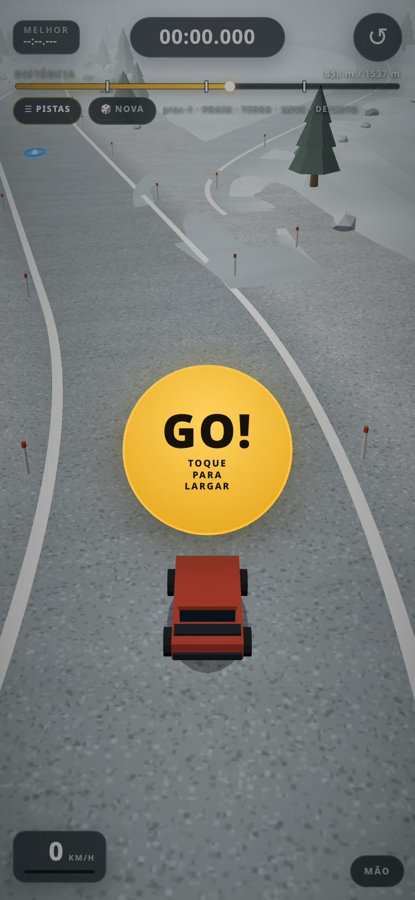

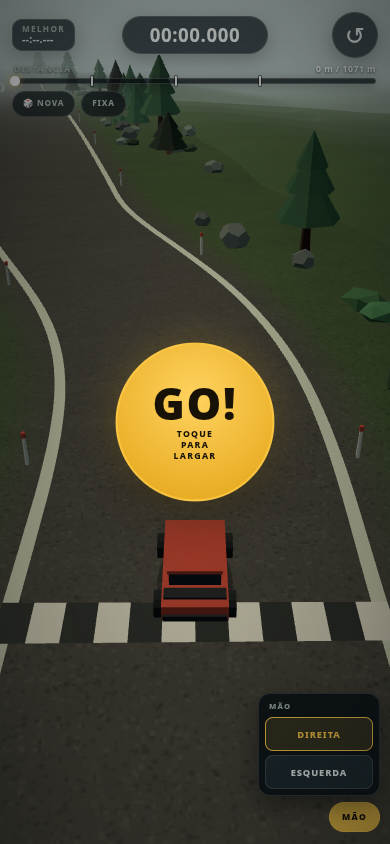

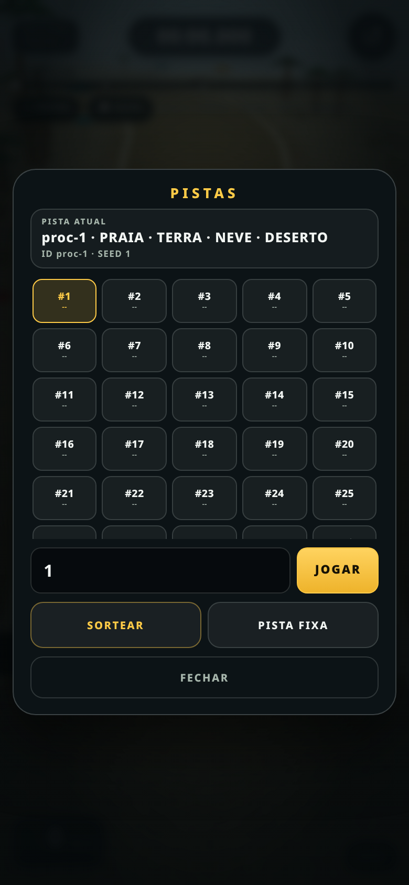

| Neve | Vilarejo |
| --- | --- |
| 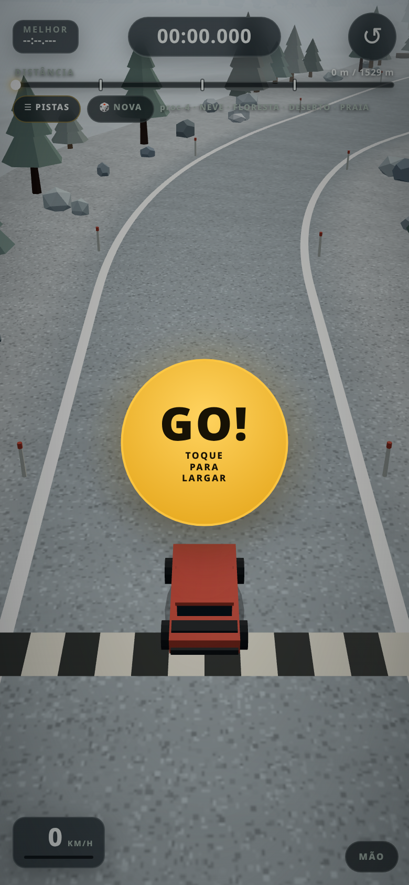 | 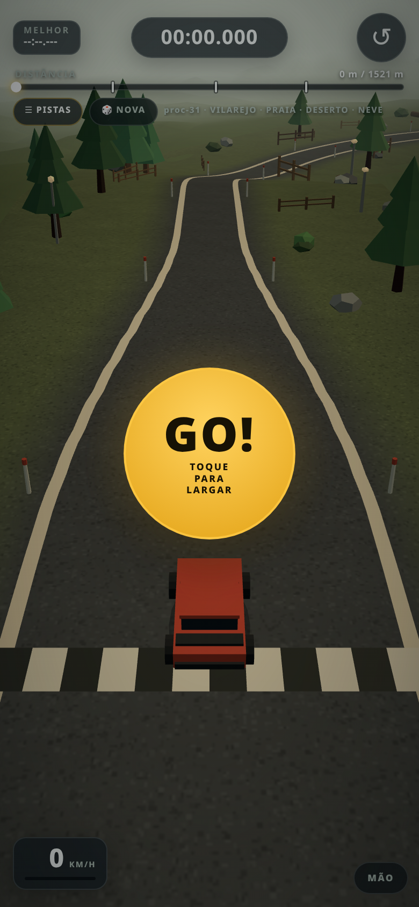 |

| Estrada de terra | Praia |
| --- | --- |
| 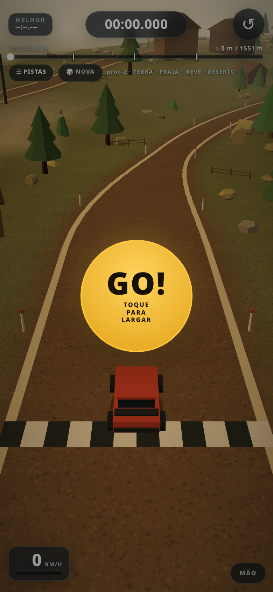 | 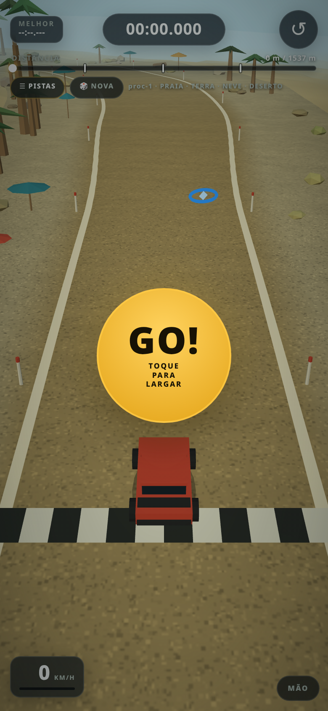 |

## Documentação

- [`Docs/Mini GDD - Rally Arcade v2.md`](Docs/Mini%20GDD%20-%20Rally%20Arcade%20v2.md) — GDD oficial v2.3
- [`Docs/Implementation Plan - Rally Arcade MVP.md`](Docs/Implementation%20Plan%20-%20Rally%20Arcade%20MVP.md)
- [`Docs/Handoff - Rally Arcade.md`](Docs/Handoff%20-%20Rally%20Arcade.md)
- [`Docs/bak_old/Mini GDD - Rally Arcade v2.md`](Docs/bak_old/Mini%20GDD%20-%20Rally%20Arcade%20v2.md) — backup do GDD v2
- [`Docs/old_Mini GDD - Rally Arcade v1.md`](Docs/old_Mini%20GDD%20-%20Rally%20Arcade%20v1.md) — GDD v1 original

## O loop

1. O jogo abre em uma **pista procedural aleatória** (seed 1–100) com o carro parado em `s = 22 m`; o botão **GO!** central (ou um toque na tela) inicia o cronômetro. Depois disso o carro **acelera sozinho**. O menu **PISTAS** troca para outra seed ou para a pista fixa.
2. Dirigir, derrapar, pular e escolher a linha. Sair da pista custa tempo; a recuperação automática mantém o relógio correndo.
3. A pista é **A→B**, com 4 setores sorteados do pool de seis cenários (floresta, deserto, neve, vilarejo, estrada de terra e praia), sem repetir o mesmo cenário em setores consecutivos. Na pista fixa, as **parciais 1, 2 e 3** ficam em `s = 250`, `500` e `750 m`, com alvos **8,9 / 17,9 / 26,8 s**. Nas pistas aleatórias as parciais ficam em 25/50/75% do traçado, no ritmo do ouro.
4. Na pista fixa, ao cruzar a faixa em `s ≈ 1093 m`, o relógio para, o carro congela e a tela de resultado abre após ~0,5 s. A largada e a chegada ficam em pontos distintos; nas pistas aleatórias a chegada fica no fim do traçado de ~1,5 km.
5. Na pista fixa, a medalha vem do tempo final: **ouro ≤ 39 s**, **prata ≤ 45 s**, **bronze ≤ 51 s**. Sem medalha, o resultado mostra quantos segundos faltaram para o bronze.
6. **CORRER DE NOVO** (ou o botão ↺ / tecla **R**) recoloca o carro na largada em menos de 1 s. **ESCOLHER PISTA** no resultado abre o menu de seeds. O melhor tempo continua no topo do HUD.

## Controles

| Ação | Touch | PC |
| --- | --- | --- |
| Iniciar | GO! central ou toque na tela | Clique no GO / W / ↑ / Enter |
| Acelerar | Automático depois do GO | Automático depois do start |
| Esterçar / derrapar | Segurar ◀ ou ▶ no stack (canto inferior direito por padrão) | A / ← (esquerda), D / → (direita) |
| Frear | Segurar FREIO na base do stack | S / ↓ |
| Frear e virar | ◀F/▶F com um dedo, ou ◀/▶ + FREIO com dois dedos | A/D + S |
| Lado do stack | Menu **MÃO**: DIREITA ou ESQUERDA, persistido | — |
| Freio de mão | Sem botão no touch por enquanto | Espaço |
| Reiniciar | Botão no topo da tela | R |
| Pista | Menu **☰ PISTAS** (seed 1–100, aleatória ou fixa) / 🎲 NOVA | Mesmos botões na tela |
| Velocímetro | Canto inferior esquerdo (km/h) | Mesmo |
| Telemetria (debug) | — | H |
| Pausa | Auto-pause ao trocar de aba; menu PISTAS pausa a corrida | — |

O carro fica parado no READY. O GO libera a largada e liga a auto-aceleração; soltar o freio volta a acelerar. O stack touch tem **5 botões**: a linha de cima é ◀/▶ puro, a linha do meio é **◀F/▶F** (esterço + freio no mesmo dedo) e embaixo fica o **FREIO** largo. Assim dá para frear e virar com um polegar, ou usar dois dedos nos botões puros. O menu **MÃO** acima do stack escolhe o lado (DIREITA/ESQUERDA) e a escolha fica em `localStorage['rally.controls.side.v1']`.

No PC o stack, o gatilho MÃO e o menu não aparecem; o GO mostra “CLIQUE OU ENTER” e o teclado continua funcionando. O freio de mão segue disponível no Espaço, mas não há botão de freio de mão no touch.

Os botões **☰ PISTAS** e **🎲 NOVA** no topo controlam a pista. O menu PISTAS mostra a pista atual, uma grade de seeds 1–100 com melhor tempo, campo para digitar seed, **SORTEAR** e **PISTA FIXA**. O boot já abre em uma procedural aleatória; **NOVA** é o atalho para sortear outra sem abrir o menu. Com o menu aberto durante a corrida, simulação e cronômetro ficam pausados.

## HUD e resultado

- **Topo esquerdo:** melhor tempo da pista (`MELHOR --:--.---` até a primeira corrida).
- **Topo central:** cronômetro `mm:ss.mmm`, parado em READY e FINISHED.
- **Topo direito:** reinício imediato.
- **Velocímetro:** canto inferior esquerdo em km/h, com barra de velocidade; espelha para a direita quando o menu MÃO deixa os controles à esquerda.
- **Menu de pistas:** **☰ PISTAS** abre a seleção de seed, **SORTEAR** e **PISTA FIXA**. 🎲 **NOVA** é o atalho aleatório. **Ao abrir, o jogo já começa em uma procedural aleatória.**
- **Barra de progresso:** distância percorrida, um marcador por parcial (250/500/750 m na fixa; 25/50/75% nas procedurais) e ponto do carro no fim do preenchimento.
- **GO!:** overlay central no READY; inicia a corrida e a auto-aceleração.
- **Controles touch:** stack de 5 botões no canto inferior direito — ◀/▶ puros, ◀F/▶F com freio e FREIO largo embaixo. O menu **MÃO** escolhe o lado; no PC todo o stack fica oculto.
- **Banner de parcial:** nome, tempo e delta (`+0,42` em vermelho, `-0,31` em verde) por ~2,5 s.
- **Resultado:** tempo total, medalha, tempos-alvo, as **3 parciais** (tempo e delta), melhor tempo, selo `NOVO RECORDE` quando aplicável, **CORRER DE NOVO** e **ESCOLHER PISTA**. O overlay escuro só intercepta toque no painel/botão; escondido, não bloqueia o canvas.
- **Powerups (topo esquerdo):** chips com nome, tempo restante e barra de duração, atualizados a ~10 Hz. Ao coletar, o nome do powerup sobe e some em ~0,75 s.

O melhor tempo fica em `localStorage['rally.best.track01-v3.v1']` para a pista fixa e em `rally.best.proc-N.v1` para cada procedural (uma chave por `track.def.id`). Se o storage estiver bloqueado, o recorde vale só para a sessão e o jogo continua normalmente.

## Powerups

Dois tipos no MVP, com ativação imediata:

| Powerup | Efeito | Duração | Pickup |
| --- | --- | --- | --- |
| **Turbo** | velocidade máxima e aceleração × 1,3 + boost de FOV | 2,0 s | anel laranja |
| **Grip extra** | grip lateral × 1,8 | 10 s | anel azul |

- **4 pickups** autorados em `src/track/track01.ts`, distribuídos pela pista: turbo em `s ≈ 426,7`, grip em `s ≈ 475,7`, turbo em `s ≈ 800,6` e turbo em `s ≈ 1048,5`; nenhum imediatamente antes das rampas. Nas pistas aleatórias são **6–8 pickups**.
- Pegar o mesmo tipo de novo **renova o timer** (nunca acumula); **tipos diferentes coexistem**. Cada pickup some ao ser coletado e volta no reinício (R), no retry e no teleporte `?s=`.
- A coleta só vale em **RUNNING**; READY, RECOVERING e FINISHED não coletam. Na recuperação os timers ficam congelados.
- O turbo não altera saltos, colisão, freio ou rampa: só velocidade, aceleração e o FOV da câmera (`CAMERA_TUNING.turboFovBoost`). O grip extra age só no grip lateral.

## Cenários, bifurcações e obstáculos móveis

- **Seis cenários:** floresta/cascalho, deserto/areia, neve, vilarejo/asfalto, estrada de terra e praia/areia de praia. As pistas procedurais sorteiam **4 setores sem repetir o mesmo cenário em sequência**.
- **Pisos com comportamento próprio:** cada cenário tem grip, aceleração, arrasto, bump, limite de velocidade e off-road no painel **Pisos**. A neve solta mais a traseira, o asfalto do vilarejo agarra mais, a terra fica entre cascalho e areia e a praia puxa para fora.
- **Poeira por piso:** cor primária/secundária, taxa, tamanho, alpha, vida, subida e gravidade mudam por cenário. O deserto usa um tom mais escuro para contrastar com a areia; a neve usa spray branco-azulado.
- **Bifurcações:** 1–2 por pista procedural. Em um trecho longo, um ramo nasce na **borda** da pista principal, corre paralelo por alguns metros, abre 28–48 m e volta a se juntar. O ramo tem spline, altura, largura, ombro externo e piso próprios; a pista principal continua como a outra opção. O jogador escolhe sem saber qual é melhor; não há recompensa exclusiva. A pista fixa continua sem bifurcação.
- **Obstáculos móveis:** 1–3 por pista procedural, com chance por setor e pelo menos um garantido. Cada evento tem um tipo do cenário (camelo, cervo, rena, carro, caminhão, trator, vaca ou buggy), começa a atravessar quando o carro se aproxima e colide como os obstáculos sólidos. A travessia é rápida (4,8–10,5 m/s) para o desvio ser uma reação curta. O começo da run fica preservado.
- **Toggle de debug:** `?hazards=0` desliga os obstáculos móveis; o painel de debug tem **Hazards ativos** e **→ Próximo hazard**.

## Carro, escape e poeira

- **Velocidade/aceleração/freio:** 39,1 m/s (~141 km/h), 11,5 m/s² e 13,8 m/s² — +15% sobre a versão anterior.
- **Fora de pista:** cada cenário tem seu próprio cap e freio extra. Floresta 65% / 10 m/s², deserto 62% / 8, neve 50% / 12, vilarejo 68% / 9, terra 55% / 11 e praia 50% / 12. Na prática, entrar a 141 km/h estabiliza em ~87–96 km/h nos pisos mais soltos, sem corte instantâneo.
- **Trepidação:** o rumble da câmera sobe para 0,15 m e é escalado pelo `bump` do piso; fora de pista sacode mais.
- **Poeira:** pool de **112 partículas** emitidas nas rodas traseiras quando há slip e velocidade acima do limiar do piso. Cada piso define taxa, tamanho, alpha, vida, subida, gravidade e duas cores; a neve usa spray branco-azulado e o deserto um tom mais escuro para contrastar com a areia. O painel **Poeira** permite ligar/desligar e ajustar taxa/tamanho/alpha.
- O tuning salvo usa `localStorage['rally.tuning.v4']`; valores antigos da v3 são ignorados.

## Painel de ajuste e debug

O debug é opt-in: **`?debug=1`** ou **`#debug`**. Sem isso, a telemetria e o painel de tuning não aparecem.

```text
https://rigato.github.io/rally-arcade/?debug=1
https://rigato.github.io/rally-arcade/?track=fixed&debug=1
https://rigato.github.io/rally-arcade/?track=fixed&debug=1&s=780
https://rigato.github.io/rally-arcade/?track=proc&seed=1&debug=1
https://rigato.github.io/rally-arcade/?track=proc&seed=1&debug=1&branch=0&bt=0.9
```

- **Sem `track`** (raiz ou `?debug=1`) o jogo sorteia uma **procedural** com seed 1–100 a cada abertura/reload.
- **`?track=fixed`** carrega a pista fixa; **`?track=proc&seed=N`** carrega uma procedural determinística (1–100). O menu **PISTAS** navega para essas URLs.
- **`?s=<metros>`** teleporta o carro para o centro da pista e volta a corrida para READY, preservando o melhor tempo. Use junto de `track=fixed` ou `track=proc&seed=N` para uma pista estável; sozinho ele teleporta em uma procedural aleatória.
- **`?hazards=0`** desliga os obstáculos móveis; sem o parâmetro eles ficam ligados. O painel Debug também tem o checkbox e um atalho para o próximo hazard.
- **`?gen=v1`** força o gerador antigo (rollback); sem o parâmetro o jogo usa o **v2**.
- **`?branch=0&bt=0.9`** (com `?debug=1`) teleporta para 90% do primeiro ramo de bifurcação; `bt` vai de 0 (entrada) a 1 (saída).
- **H** alterna a telemetria no desktop; no painel, a pasta **Debug** também controla piso forçado, colisores, hazards, reposicionar e ir para um `s`.
- O painel cobre **Carro**, **Carroceria**, **Câmera**, **Input**, **Pisos**, **Poeira**, **Powerups / Corrida** e **Debug**. O Input agora só tem as suavizações de esterço/freio; os parâmetros de derrapagem ficam em **Carro**.
- Todo ajuste vale na hora porque física, câmera, input e corrida leem os mesmos objetos mutáveis de `src/game/config.ts`.
- Alterações são salvas em `localStorage['rally.tuning.v4']` com debounce de ~200 ms. **Resetar tuning** volta aos defaults e apaga a chave.
- **Copiar JSON** exporta o tuning atual; se o clipboard for bloqueado, abre um textarea para copiar manualmente.

## Comandos

```bash
npm install       # instala dependências
npm run dev       # servidor de desenvolvimento com --host
npm run build     # typecheck + build de produção em dist/
npm run preview   # serve o build localmente
npm run typecheck # apenas TypeScript
npm run validate:track # valida comprimento, raio, rampas, parciais, powerups e obstáculos
```

Requer Node 24+.

## Estrutura

```text
src/
├── main.ts              # bootstrap: loadTuning() antes do Game
├── style.css            # reset mobile, HUD, progresso, parcial, resultado e safe areas
├── game/
│   ├── Game.ts          # renderer, cena, loop, estados e orquestração da corrida
│   ├── Race.ts          # relógio, parcial, medalhas, melhor tempo e snapshot
│   ├── config.ts        # defaults tipados de tuning (objetos mutáveis)
│   ├── scenarios.ts     # registro de cenários, pisos, paletas, poeira e hazards
│   ├── types.ts         # tipos compartilhados (estado, tuning, pista)
│   ├── tuningStore.ts   # localStorage, merge, reset e export JSON
│   └── debug.ts         # detecção de ?debug=1 / #debug
├── core/
│   ├── Loop.ts          # passo fixo 120 Hz + acumulador + alpha
│   ├── Spring.ts        # mola/amortecedor da suspensão visual
│   └── math.ts          # clamp, lerp e suavização exponencial
├── car/
│   ├── Car.ts           # física de derrapagem, saltos e pose congelada na chegada
│   └── CarView.ts       # carro low poly + rodas + sombra blob
├── camera/
│   └── ChaseCamera.ts   # câmera de perseguição
├── input/
│   └── Input.ts         # GO, auto-throttle, 5 botões, teclado e multi-touch
├── track/
│   ├── track01.ts       # pista fixa A→B (seed 91, ~1097 m, 4 setores)
│   ├── Track.ts         # spline, sampler, altura, superfícies e ramos
│   ├── TrackBranch.ts   # sampler de um ramo de bifurcação
│   ├── TrackMesh.ts     # pista, ombros, placas e portais
│   ├── ForkMesh.ts      # malha dos ramos de bifurcação
│   ├── Gates.ts         # portais em cada troca de setor + chegada
│   ├── zones.ts         # mistura de paletas nos limites das zonas
│   ├── Obstacles.ts     # obstáculos sólidos e colisão
│   ├── Hazards.ts       # obstáculos móveis, travessia e colisão
│   ├── Powerups.ts      # pickups de turbo/grip, timers e efeitos na física
│   └── procedural/      # gerador por seed e validação do protótipo
├── world/
│   ├── Scenery.ts       # cenário instanciado por setor (6 famílias)
│   └── Environment.ts   # céu, névoa e luz multi-zona
└── ui/
    ├── Hud.ts           # cronômetro, melhor, progresso, parcial, recuperação e debug
    ├── TrackMenu.ts     # menu de seeds, aleatória e pista fixa
    ├── Results.ts       # overlay de chegada, medalha, retry e escolher pista
    ├── format.ts        # formatação de tempo e delta
    └── TuningPanel.ts   # lil-gui em ?debug=1
```

Na raiz, `scripts/` reúne `validate-track.ts`, `select-track.ts`, `freeze-track.ts`, `proc-validate.ts` e `proc-diversity.ts`. A pista fixa foi congelada da seed 91 do gerador legado com `select-track.ts` e `freeze-track.ts`.

## Protótipo procedural

O gerador de pistas por seed fica em `src/track/procedural/`:

O gerador padrão é o **v2** (`ProceduralTrackV2.ts`). Ele usa a pista principal do v1 e replaneja as bifurcações como mini traçados de verdade — waypoints em mundo, curvas próprias, relevo e validação. A rotina v1 (`ProceduralTrack.ts`) continua intacta e pode ser usada para rollback com **`?gen=v1`**.

- `generateProceduralTrackV2(seed)` gera a espinha principal com a v1 e substitui `def.forks` por 1–2 ramos v2. Cada ramo tem janela de 170–340 m, 2–3 apexes, deslocamento longitudinal/lateral próprio, comprimento 3D de ~190–345 m e largura 5,5–8 m. O ramo começa/termina na borda, com lead-in/lead-out alinhados à tangente. A v1 é devolvida intacta se a validação falhar.
- `generateProceduralTrack(seed)` (v1) usa uma **gramática de segmentos**: retas de ~20–90 m e curvas sorteadas entre **sete categorias** — longa (R≈70–110 m), média (45–65 m), curta (28–38 m), cotovelo (26–31 m), **hairpin normal (20–23 m)**, **hairpin extremo (13–14 m)** e **mudança de rota / kink (R≈140–220 m, sweep 6–15°)**. Cada seed usa **exatamente 1 hairpin extremo**, 0–1 normal, 1–3 kinks e pelo menos quatro categorias, com curvas nos dois sentidos.
- O **hairpin extremo** tem sweep 170–185°, largura local **5,2–6,2 m**, aproximação reta de 45–60 m e saída de 35–60 m; fica a ≥80 m da largada/chegada. É o ponto que exige frear de verdade.
- Candidatos são rejeitados se trechos não vizinhos ficarem a menos de **40 m** entre centros (as duas pernas do próprio hairpin extremo são a exceção), se o layout passar de ~650×650 m ou se a chegada ficar a menos de **100 m** da largada. O resultado é sempre uma pista **A→B**.
- **Setores:** 4 setores de **340–470 m** sorteados do pool de seis cenários, sem repetir o mesmo em sequência; pista total **1518–1625 m**. São 6–8 powerups, 50–75 obstáculos, 1–2 rampas e **1–2 bifurcações**.
- **Relevo:** amplitudes ~20% maiores, com 2–3 **platôs planos** de 70–150 m cobrindo 20–25% da pista.
- **Largura agressiva:** base 10,5–12 m, trechos largos 13–15 m, longos estreitos 5,5–7 m e **chokes de 4,6–5,4 m**. O sampler (`Track.ts`) aceita **4,4–15,2 m**.
- **Bifurcações v2:** 1–2 por pista; o gerador escolhe uma janela de 170–340 m na pista principal e constrói o ramo com 2–3 apexes em coordenadas de mundo, lead-in/lead-out e relevo próprios. O ramo começa/termina na borda, tem 190–345 m de comprimento 3D e 5,5–8 m de largura; a pista principal continua como a outra opção. As duas pontas ficam no mesmo setor.
- **Hazards:** 1–3 por seed, com chance por setor; o tipo vem do cenário (camelo, cervo, rena, carro, caminhão, trator, vaca ou buggy). O gerador preserva os primeiros 130 m, rampas, hairpin extremo e bifurcações.
- **Medalhas procedurais:** ouro **39 s em 1.300 m → 49 s em 1.650 m** (linear, clampado); nas pistas atuais de 1.518–1.624 m fica **45,2–48,3 s**. Prata = ouro + 6 s; bronze = ouro + 12 s. As parciais usam o ritmo do ouro.
- `validateProceduralTrack(def)` usa o mesmo `Track` do jogo e valida comprimento, raio mínimo, autointerseção, separação, rampas, splits, powerups, obstáculos, bifurcações e hazards.
- `generateLegacyProceduralTrack(seed)` preserva a serpentina antiga de 4 pernas, usada para reproduzir a pista fixa `track01-v3`. As pistas aleatórias usam o gerador novo.

Validação atual: **100/100 seeds** (1–100), comprimento **1518,3–1623,7 m**, setores ~**354–438 m**, raio mínimo **12,6–13,8 m**, largura **4,6–15,0 m**, separação mínima **41,2 m**, A→B **109,2–787,9 m**, 20–25% de pista plana, exatamente **1 hairpin extremo por seed**, **1–2 bifurcações** e **1–3 hazards** por seed.

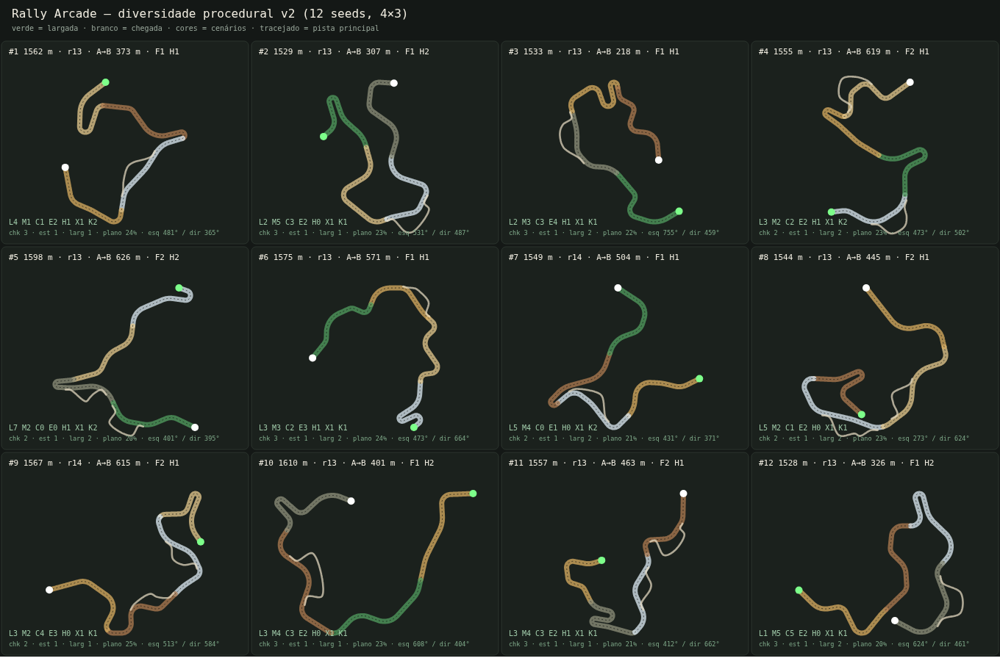

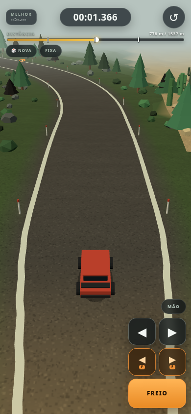

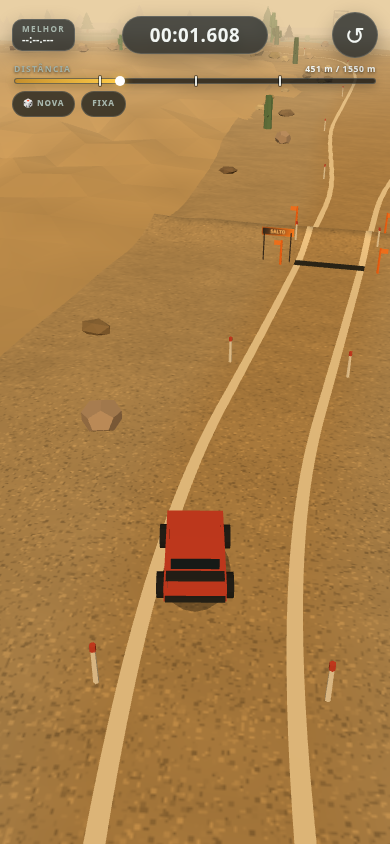

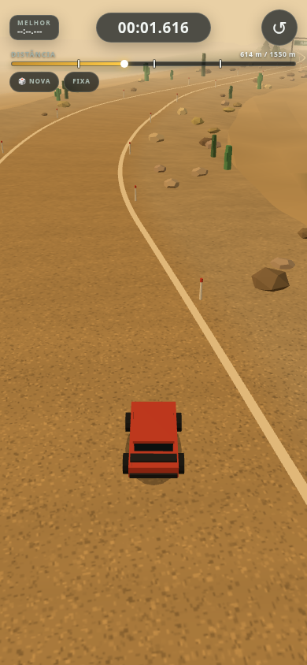

Teste as seeds e gere um preview top-down ou um contact sheet:

```bash
npx --yes tsx scripts/proc-validate.ts
npx --yes tsx scripts/proc-validate.ts --count 100 --start 1
npx --yes tsx scripts/proc-validate.ts --gen v2 --count 100 --start 1
npx --yes tsx scripts/proc-validate.ts --svg /tmp/opencode/pista.svg
npx --yes tsx scripts/proc-diversity.ts --count 12 --svg /tmp/opencode/proc-sheet.svg
npx --yes tsx scripts/proc-diversity.ts --gen v2 --count 12 --svg /tmp/opencode/proc-sheet-v2.svg
```

A integração está pronta: `?track=proc&seed=1` (com ou sem `?debug=1`) usa o **gerador v2**; `?gen=v1` volta ao gerador antigo. Na tela, **☰ PISTAS** abre o menu de seeds 1–100, **🎲 NOVA** sorteia uma seed e **PISTA FIXA** (dentro do menu) volta à pista A→B. O editor de pista continua fora do escopo.

## Deploy

O workflow [`.github/workflows/deploy.yml`](.github/workflows/deploy.yml) publica o build no GitHub Pages a cada push na `main` (ou manualmente via `workflow_dispatch`). O Pages já está configurado com **Source: GitHub Actions**.

URL publicada: <https://rigato.github.io/rally-arcade/>

O `vite.config.ts` usa `base: './'` para funcionar no subcaminho do Pages. O deploy é validado com HTTP 200 e smoke test live nas pistas fixa A→B e procedural.

## Roadmap

- **M0 — Fundação** (concluído): Vite + TS + Three, canvas portrait, loop fixo, HUD shell, Actions/Pages.
- **M1 — Carro e feeling** (concluído): física de derrapagem, touch/mouse/teclado, freio, freio de mão, câmera, carro low poly e painel de tuning.
- **M2 — Pisos** (concluído): cascalho e areia, troca por zona.
- **M3 — Pista** (concluído): spline, elevação, largura, saltos, cenário e portais.
- **M4 — Fora da pista** (concluído): terreno acidentado, obstáculos, colisão e recuperação com penalidade.
- **M5 — Corrida completa** (concluído): cronômetro, distância, parcial, medalhas, resultado, melhor tempo persistido e reinício instantâneo.
- **M5b — Powerups** (concluído): pickups 3D de turbo e grip extra, efeitos reais na física, chips com timers no HUD e restauração no reinício/teleporte.
- **Pista v2** (substituída): circuito fechado de ~1035 m, 4 setores, curvas de raio ≥ 36 m e 3 parciais; reprovado no playtest por ser fechado.
- **Controles v3** (substituída): GO, auto-aceleração, 3 botões touch e teclado invertido corretamente.
- **Controles v4** (em playtest): 5 botões touch com combos ◀F/▶F, menu MÃO à esquerda/direita e stack oculto no PC.
- **Pista A→B** (em playtest): seed 91 congelada, 1096,8 m, 4 setores, raio mínimo 30,2 m, 2 rampas baixas, 3 parciais e 50 obstáculos.
- **Física v5** (em playtest): aceleração/velocidade/freio +15%, off-road com cap de 65%/62% e desaceleração suave, rumble mais forte.
- **Poeira v8** (em playtest): pool 112, perfis por piso, partículas maiores/mais altas, dissipação em ~0,8–1,0 s e contraste melhorado no deserto.
- **Hairpin extremo v7** (em playtest): 1 por pista, 13–14 m, aproximação/saída retas e largura 5,2–6,2 m.
- **Cenários v8** (em playtest): floresta, deserto, neve, vilarejo, estrada de terra e praia; 4 setores sorteados por pista, com pisos e poeira próprios.
- **Bifurcações v8** (em playtest): 1–2 ramos com spline/altura/largura próprios por pista; a pista principal continua como a outra opção.
- **Hazards v8** (em playtest): 1–3 obstáculos móveis por pista, com tipo por cenário, travessia e colisão; `?hazards=0` desliga.
- **Menu de pistas v8** (em playtest): grade de seeds 1–100 com melhor tempo, campo de seed, SORTEAR e PISTA FIXA; pausa a corrida enquanto aberto.
- **Velocímetro v8** (em playtest): km/h e barra de velocidade no canto inferior, espelhado conforme o lado dos controles.
- **Medalhas v7** (em playtest): fixa 39/45/51 s; procedurais 45,2–48,3 s de ouro, com parciais no ritmo do ouro.
- **Default procedural** (em playtest): abrir `/` sorteia uma seed 1–100; `?track=fixed` / menu PISTAS carrega a pista fixa.
- **Protótipo procedural v8** (em playtest): sete tipos de curva (incluindo hairpin extremo 13–14 m e kink), setores de 340–470 m, platôs, chokes, seis cenários, bifurcações e hazards; 100/100 seeds.
- **Gerador v2 de bifurcações** (em playtest): ramos com waypoints/curvas/relevo próprios, 190–345 m; `?gen=v1` mantém o gerador anterior para rollback.

Fora do MVP: progressão, loja, editor de pistas, áudio e multiplayer.
