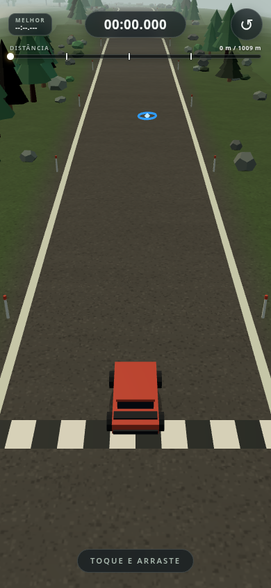

# Rally Arcade

Protótipo de corrida arcade de rally para celular em **portrait**, jogável com uma mão só. O carro derrapa, os pisos mudam o grip e cada corrida termina com tempo, três parciais e medalha.

Stack: **Vite + TypeScript estrito + Three.js**, física própria (sem engine), UI em DOM/CSS sobre o canvas.

**Jogue agora:** <https://rigato.github.io/rally-arcade/>

> Status: **MVP completo — M5, com powerups (M5b) e pista v2 multi-zona**. O ciclo largada → 3 parciais → chegada → medalha → reinício está fechado, com cronômetro, barra de progresso, melhor tempo persistido, tela de resultado e pickups de turbo/grip. Falta apenas o playtest em celular real e a calibração final dos tempos.

## Screenshot



## Documentação

- [`Docs/Mini GDD - Rally Arcade v2.md`](Docs/Mini%20GDD%20-%20Rally%20Arcade%20v2.md)
- [`Docs/Implementation Plan - Rally Arcade MVP.md`](Docs/Implementation%20Plan%20-%20Rally%20Arcade%20MVP.md)

## O loop

1. O carro larga em `s = 22 m` com o cronômetro zerado. O **primeiro toque** (ou tecla de acelerar) inicia a corrida.
2. Dirigir, derrapar, pular e escolher a linha. Sair da pista custa tempo; a recuperação automática mantém o relógio correndo.
3. A pista tem **4 setores intercalados** (floresta → deserto → floresta → deserto). Em `s = 250`, `500` e `750 m` aparecem as **parciais 1, 2 e 3**, com tempo e diferença contra os alvos provisórios (13,5 s / 27 s / 40,5 s).
4. Ao cruzar a faixa em `s ≈ 1031 m`, o relógio para, o carro congela e a tela de resultado abre após ~0,5 s.
5. A medalha vem do tempo final: **ouro ≤ 55 s**, **prata ≤ 62 s**, **bronze ≤ 72 s**. Sem medalha, o resultado mostra quantos segundos faltaram para o bronze.
6. **CORRER DE NOVO** (ou o botão ↺ / tecla **R**) recoloca o carro na largada em menos de 1 s. O melhor tempo continua no topo do HUD.

## Controles

| Ação | Touch (uma mão) | PC |
| --- | --- | --- |
| Acelerar | Tocar e segurar na tela | Mouse pressionado / W / ↑ |
| Esterçar / derrapar | Arrastar o dedo na horizontal | Mover o mouse / A, D / ←, → |
| Frear | Soltar o dedo (rampa progressiva) | Soltar o mouse / S / ↓ |
| Freio de mão | Arrastar além do limite de esterço (padrão) ou botão dedicado | Espaço |
| Reiniciar | Botão no topo da tela | R |
| Telemetria (debug) | — | H |
| Pausa | Auto-pause ao trocar de aba | — |

O freio de mão pode alternar entre **deslocamento** e **botão** no painel de debug. No modo botão, o alvo aparece no canto inferior direito do HUD.

## HUD e resultado

- **Topo esquerdo:** melhor tempo da pista (`MELHOR --:--.---` até a primeira corrida).
- **Topo central:** cronômetro `mm:ss.mmm`, parado em READY e FINISHED.
- **Topo direito:** reinício imediato.
- **Barra de progresso:** distância percorrida em metros, um marcador por parcial (250/500/750 m) e ponto do carro no fim do preenchimento.
- **Banner de parcial:** nome, tempo e delta (`+0,42` em vermelho, `-0,31` em verde) por ~2,5 s.
- **Resultado:** tempo total, medalha, tempos-alvo, as **3 parciais** (tempo e delta), melhor tempo, selo `NOVO RECORDE` quando aplicável e o botão grande **CORRER DE NOVO**. O overlay escuro só intercepta toque no painel/botão; escondido, não bloqueia o canvas.
- **Powerups (canto inferior esquerdo):** chips com nome, tempo restante e barra de duração, atualizados a ~10 Hz. Ao coletar, o nome do powerup sobe e some em ~0,75 s, sem vinheta de impacto.

O melhor tempo fica em `localStorage['rally.best.track01.v1']` (uma chave por `track.def.id`). Se o storage estiver bloqueado, o recorde vale só para a sessão e o jogo continua normalmente.

## Powerups

Dois tipos no MVP, com ativação imediata:

| Powerup | Efeito | Duração | Pickup |
| --- | --- | --- | --- |
| **Turbo** | velocidade máxima e aceleração × 1,3 + boost de FOV | 2,0 s | anel laranja |
| **Grip extra** | grip lateral × 1,8 | 10 s | anel azul |

- **6 pickups autorados** em `src/track/track01.ts`, distribuídos pelos 4 setores: grip em `s = 60`, turbo em `s = 160` (depois do pouso da rampa 1), grip em `s = 420` (antes da curva SE), turbo em `s = 610` (depois do pouso da rampa 2), grip em `s = 690` (antes da curva SO) e turbo em `s = 850`.
- Pegar o mesmo tipo de novo **renova o timer** (nunca acumula); **tipos diferentes coexistem**. Cada pickup some ao ser coletado e volta no reinício (R), no retry e no teleporte `?s=`.
- A coleta só vale em **RUNNING**; READY, RECOVERING e FINISHED não coletam. Na recuperação os timers ficam congelados.
- O turbo não altera saltos, colisão, freio ou rampa: só velocidade, aceleração e o FOV da câmera (`CAMERA_TUNING.turboFovBoost`). O grip extra age só no grip lateral.

## Painel de ajuste e debug

O debug é opt-in: **`?debug=1`** ou **`#debug`**. Sem isso, a telemetria e o painel de tuning não aparecem.

```text
https://rigato.github.io/rally-arcade/?debug=1
https://rigato.github.io/rally-arcade/?debug=1&s=780
```

- **`?s=<metros>`** teleporta o carro para o centro da pista e volta a corrida para READY, preservando o melhor tempo. É útil para revisar a pista e testar a chegada.
- **H** alterna a telemetria no desktop; no painel, a pasta **Debug** também controla piso forçado, colisores, reposicionar e ir para um `s`.
- O painel cobre **Carro**, **Câmera**, **Input**, **Pisos**, **Powerups / Corrida** e **Debug**. Os tempos-alvo de medalha, o alvo da parcial e os multiplicadores/durações dos powerups são editáveis ao vivo.
- Todo ajuste vale na hora porque física, câmera, input e corrida leem os mesmos objetos mutáveis de `src/game/config.ts`.
- Alterações são salvas em `localStorage['rally.tuning.v1']` com debounce de ~200 ms. **Resetar tuning** volta aos defaults e apaga a chave.
- **Copiar JSON** exporta o tuning atual; se o clipboard for bloqueado, abre um textarea para copiar manualmente.

## Comandos

```bash
npm install       # instala dependências
npm run dev       # servidor de desenvolvimento com --host
npm run build     # typecheck + build de produção em dist/
npm run preview   # serve o build localmente
npm run typecheck # apenas TypeScript
npm run validate:track # valida comprimento, raio, rampas, parciais, powerups e obstáculos
```

Requer Node 24+.

## Estrutura

```text
src/
├── main.ts              # bootstrap: loadTuning() antes do Game
├── style.css            # reset mobile, HUD, progresso, parcial, resultado e safe areas
├── game/
│   ├── Game.ts          # renderer, cena, loop, estados e orquestração da corrida
│   ├── Race.ts          # relógio, parcial, medalhas, melhor tempo e snapshot
│   ├── config.ts        # defaults tipados de tuning (objetos mutáveis)
│   ├── types.ts         # tipos compartilhados (estado, tuning, pista)
│   ├── tuningStore.ts   # localStorage, merge, reset e export JSON
│   └── debug.ts         # detecção de ?debug=1 / #debug
├── core/
│   ├── Loop.ts          # passo fixo 120 Hz + acumulador + alpha
│   ├── Spring.ts        # mola/amortecedor da suspensão visual
│   └── math.ts          # clamp, lerp e suavização exponencial
├── car/
│   ├── Car.ts           # física de derrapagem, saltos e pose congelada na chegada
│   └── CarView.ts       # carro low poly + rodas + sombra blob
├── camera/
│   └── ChaseCamera.ts   # câmera de perseguição
├── input/
│   └── Input.ts         # touch, mouse e teclado
├── track/
│   ├── track01.ts       # pista fixa v2 autorada (~1 km, 4 setores)
│   ├── Track.ts         # spline, sampler, altura e validação
│   ├── TrackMesh.ts     # pista, ombros, placas e portais
│   ├── Gates.ts         # portais em cada troca de setor + chegada
│   ├── zones.ts         # mistura de paletas nos limites das zonas
│   ├── Obstacles.ts     # obstáculos sólidos e colisão
│   └── Powerups.ts      # pickups de turbo/grip, timers e efeitos na física
├── world/
│   ├── Scenery.ts       # cenário instanciado por setor (floresta/deserto)
│   └── Environment.ts   # céu, névoa e luz multi-zona
└── ui/
    ├── Hud.ts           # cronômetro, melhor, progresso, parcial, recuperação e debug
    ├── Results.ts       # overlay de chegada, medalha e retry
    ├── format.ts        # formatação de tempo e delta
    └── TuningPanel.ts   # lil-gui em ?debug=1
```

## Deploy

O workflow [`.github/workflows/deploy.yml`](.github/workflows/deploy.yml) publica o build no GitHub Pages a cada push na `main` (ou manualmente via `workflow_dispatch`). O Pages já está configurado com **Source: GitHub Actions**.

URL publicada: <https://rigato.github.io/rally-arcade/>

O `vite.config.ts` usa `base: './'` para funcionar no subcaminho do Pages. O deploy do commit `37cf79e` foi validado com HTTP 200 e smoke test headless.

## Roadmap

- **M0 — Fundação** (concluído): Vite + TS + Three, canvas portrait, loop fixo, HUD shell, Actions/Pages.
- **M1 — Carro e feeling** (concluído): física de derrapagem, touch/mouse/teclado, freio, freio de mão, câmera, carro low poly e painel de tuning.
- **M2 — Pisos** (concluído): cascalho e areia, troca por zona.
- **M3 — Pista** (concluído): spline, elevação, largura, saltos, cenário e portais.
- **M4 — Fora da pista** (concluído): terreno acidentado, obstáculos, colisão e recuperação com penalidade.
- **M5 — Corrida completa** (concluído): cronômetro, distância, parcial, medalhas, resultado, melhor tempo persistido e reinício instantâneo.
- **M5b — Powerups** (concluído): pickups 3D de turbo e grip extra, efeitos reais na física, chips com timers no HUD e restauração no reinício/teleporte.
- **Pista v2** (concluído): ~1035 m, 4 setores intercalados, curvas de raio ≥ 36 m, ombros de 12 m, 2 rampas baixas e 3 parciais.

Fora do MVP: progressão, loja, pista procedural, áudio e cenários extras.
